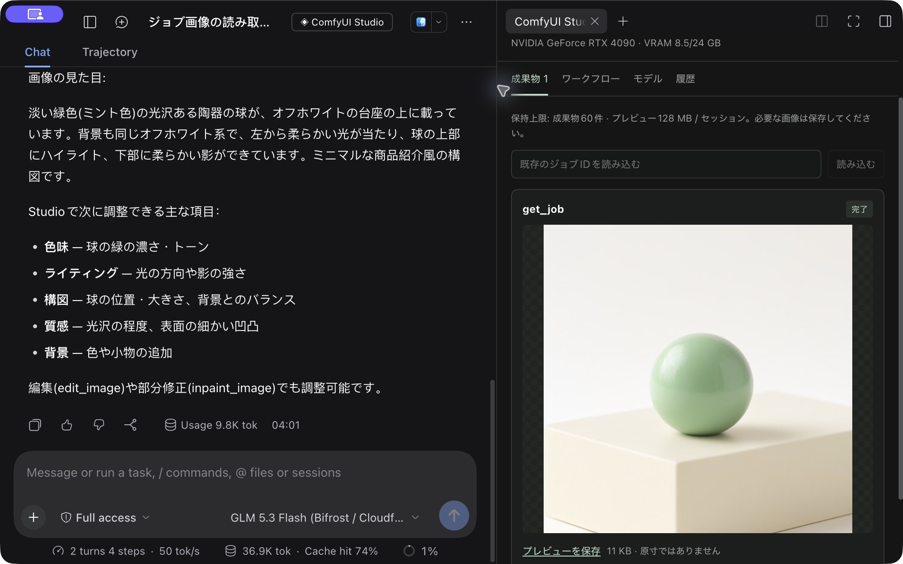
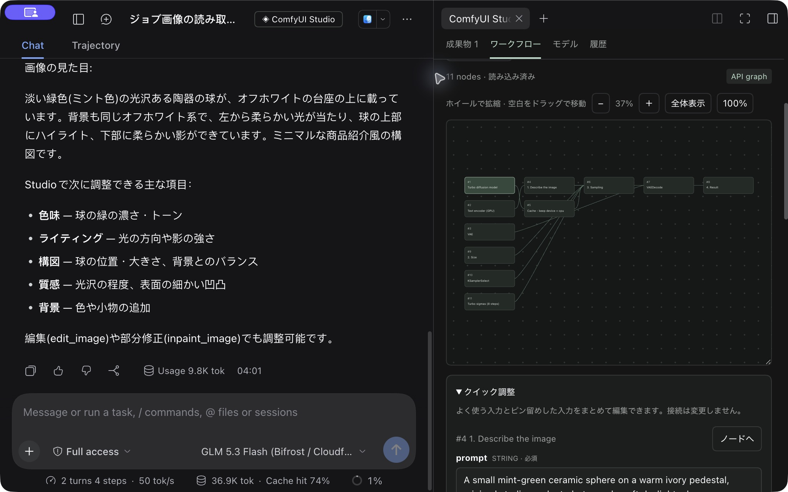
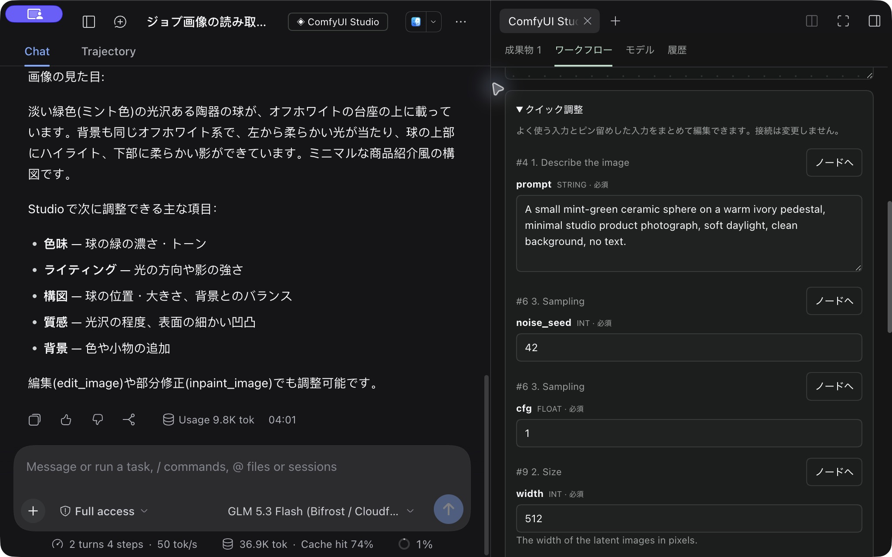

# dsh-comfyui

Operate ComfyUI from DSH chat, review generated images, and adjust workflows in the same window. This plugin bundles a dedicated **ComfyUI Operator**, the **Studio** side panel, and a self-hosted **MCP/REST Gateway** that supports OAuth connections. You will need a working ComfyUI installation and models separately.

Discuss a result or the next adjustment in chat while reviewing images in the right-hand panel.



Use the mouse wheel to zoom the API Graph and drag empty space to pan. Input fields are generated from the connected ComfyUI instance's node definitions, allowing you to adjust prompts, seeds, dimensions, and other parameters.



<details>
<summary>Quick adjustments for prompts, seeds, and other inputs</summary>



</details>

The screenshots show one example environment. GPU name, VRAM, and ComfyUI version come from the connected ComfyUI instance. Models are selected through your configuration or workflow. Bundling the Gateway does not automatically update or start an existing server.

| Location | Purpose |
| --- | --- |
| `lib/`, `src/` | Operator, Studio, and the DSH MCP bridge |
| `gateway/app/` | Python Gateway connecting to ComfyUI |
| `test/`, `gateway/tests/` | Regression tests that do not require a GPU |

## Install in DSH

```sh
npm ci
npm run build
# Connect to an existing remote Gateway
npm run connection -- --url https://YOUR-GATEWAY/mcp
npm run login
npm run verify
# Add the plugin to your DSH profile
~/.local/bin/dsh plugin --profile desktop add "$PWD"
```

The default endpoint is `http://127.0.0.1:8790/mcp`. Connection settings are stored in
`~/.dsh/dsh-comfyui/connection.json`. HTTPS and loopback-only HTTP are supported.
Override settings with `DSH_COMFYUI_MCP_URL`, `DSH_COMFYUI_AUTH_DIR`, or `DSH_COMFYUI_NODE`.
The bridge uses mcp-remote for the Gateway's existing OAuth flow; no embedded Service Token is required.

Select **ComfyUI Operator** in DSH to use the Studio panel for results, the API Graph, and node-definition-driven input editing.
Zoom with the mouse wheel and pan by dragging empty space. The agent can read a browser draft only after you explicitly share it.
Generation and saving use a shared action path with request-ID deduplication and reconciliation of uncertain submissions.
History, previews, and finalized submission records have count and/or size limits. Pruning history never makes an unresolved operation safe to resend.

## Run the bundled Gateway

Install Python 3.12 or later and uv on the GPU machine, then follow the [Gateway guide](gateway/README.md).

```sh
uv sync --project gateway
mkdir -p "$HOME/.config/dsh-comfyui"
cp gateway/.env.example "$HOME/.config/dsh-comfyui/gateway.env"
chmod 600 "$HOME/.config/dsh-comfyui/gateway.env"
# Edit COMFY_URL, Access settings, and allowed users
export DSH_COMFYUI_GATEWAY_ENV_FILE="$HOME/.config/dsh-comfyui/gateway.env"
npm run gateway:check
npm run gateway
```

By default, the Gateway listens on `127.0.0.1:8790` and rejects MCP/REST access when authentication is not configured.
For loopback development only, use `GW_DEV_NO_AUTH=1 npm run gateway`.
Cloudflare Access OAuth exposure must be configured separately; the Gateway itself is not an OAuth authorization server.
MCP is available at `/mcp` and REST at `/api/*`. Saving over an existing workflow requires explicit `overwrite:true`.

```sh
npm run verify:discovery # Initialize and list tools without querying the GPU
npm test                # Plugin and Gateway regression tests
```

## Distribution

Keep connection settings, authentication, and runtime data outside the repository. See [configuration](docs/configuration.md).
To prepare a clean source distribution, export only the allowlisted files without Git history.

```sh
npm run release:check
npm run release:export -- /absolute/path/to/dsh-comfyui-public
```

The export excludes Git history, personal settings, authentication caches, runtime images, logs, and installed dependencies.
It stops if the destination already exists. It does not publish to GitHub or npm.

Licensed under [MIT](LICENSE). See [NOTICE](NOTICE) and [prior art](docs/prior-art.md) for third-party attribution and licenses.
ComfyUI, models, and custom nodes have their own licenses.
